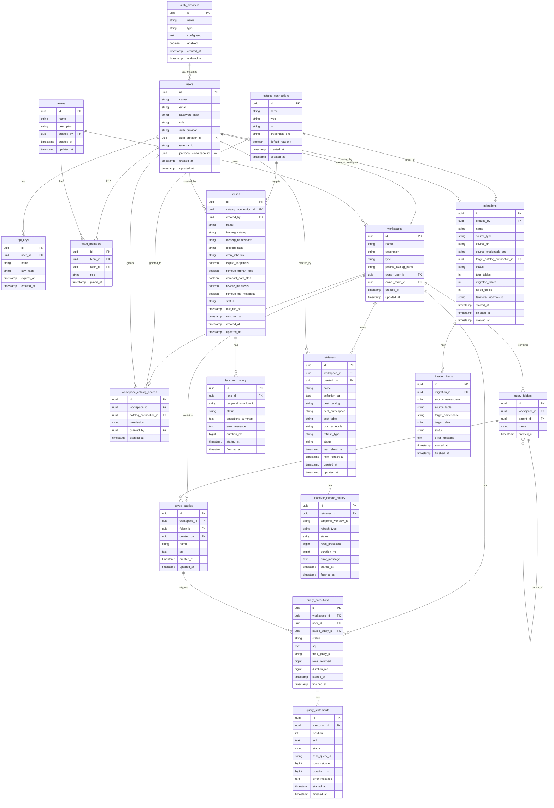

# 🐋 Baleia

First-class UI for Trino + Apache Iceberg catalog management platform.

## Stack

- **Frontend:** TypeScript + Svelte 5 + Monaco Editor
- **Backend:** Go (Chi, nhooyr/websocket, sqlc)
- **Orchestration:** Temporal.io
- **Database:** CockroachDB
- **Catalog:** Apache Polaris
- **Query engine:** Trino

## Dev

```bash
# Start local infrastructure
make compose-up

# Run API
make dev

# Run Temporal worker
make worker

# Generate sqlc code
make sqlc
```


