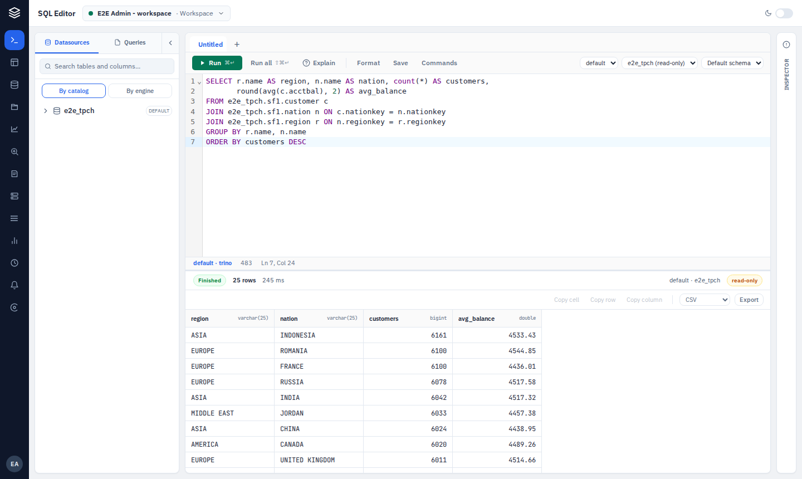

<p align="center">
  
</p>

# Baleia

**A self-hosted SQL workspace for your data platform.** Write and run SQL against Trino and your databases, browse every catalog in one place, and share queries, metrics and models with your team.



## What you can do

- **Write and run SQL.** Use tabs, autocomplete that knows your tables and columns, formatting and EXPLAIN. Run one statement or a whole script, and scroll through large results or export them as CSV, TSV, JSON Lines or Arrow.
- **Query many engines from one place.** Trino, plus PostgreSQL, MySQL/MariaDB, SQL Server, Oracle, ClickHouse, SQLite and Arrow Flight SQL directly.
- **Connect your lakehouse.** Register Polaris, Nessie, Lakekeeper, Iceberg REST, Unity, AWS Glue or Hive Metastore, and Baleia sets up the matching Trino catalog for you.
- **Find your data.** Browse catalogs, schemas, tables and columns, search across them, and document tables right next to the data.
- **Share and reuse.** Keep saved queries, metrics and semantic models in team spaces, each with version history. Build questions in **Explore** by clicking dimensions and metrics instead of writing SQL.
- **Keep an eye on things.** See the cluster, running queries, query history and Iceberg table health, and run table maintenance.
- **Control access.** Use workspaces, teams and roles, sign in with OIDC or LDAP, create API keys, and review everything in the audit trail.
- **Bring in AI, if you want.** An optional assistant, plus an MCP server so your own agents can query within the limits you set.

The interface is available in English and Brazilian Portuguese.

## Try it

You need Docker. This starts Baleia with Trino, Polaris and everything else it needs:

```bash
git clone https://github.com/maltzsama/baleia.git
cd baleia
make up
```

Open http://localhost:8080. On first visit, a setup wizard creates your admin account.

## Install on Kubernetes

Each release publishes a container image and a Helm chart:

```bash
helm install baleia oci://ghcr.io/maltzsama/charts/baleia --version 0.3.0 # x-release-please-version
```

Settings are listed in [docs/configuration.md](docs/configuration.md), and running it in production is covered in [docs/operations.md](docs/operations.md). Upgrading from 0.3? Read [Upgrading to 0.4.0](docs/operations.md#upgrading-to-040) first.

## Documentation

| | |
|---|---|
| [Configuration](docs/configuration.md) | Every setting, and how credentials are encrypted |
| [Operations](docs/operations.md) | Metrics, alerts, the audit trail and runbooks |
| [Connections](docs/connections.md) | Every source and catalog Baleia can connect to |
| [Architecture](docs/architecture.md) | How Baleia is built, how a query runs, and the Trino security model |
| [Secrets](docs/secrets.md) · [LDAP](docs/ldap.md) · [Observability](docs/observability.md) | Specific topics |
| [Assistant](docs/assistant.md) · [MCP](docs/mcp.md) | AI features |
| [Development](docs/development.md) | Running from source, tests, and adding a provider |
| [Releasing](docs/releasing.md) | How versions are cut and published |
| [Decision records](docs/adr/README.md) | Why things are the way they are |

## Status

Baleia is in beta and moving fast; expect changes between minor versions. Bugs and ideas are welcome in [issues](https://github.com/maltzsama/baleia/issues).

## Contributing

Baleia is mostly a one-person project for now, and help is welcome, especially on the web app (Svelte 5). Start with [docs/development.md](docs/development.md) and [AGENTS.md](AGENTS.md), then open an issue or a pull request. Code, comments and docs are written in English.

## Credits

The Baleia icon is the ["pet" icon](https://www.flaticon.com/free-icon/pet_7688189)
by bsd from [Flaticon](https://www.flaticon.com)
([Tv show icons created by bsd - Flaticon](https://www.flaticon.com/free-icons/tv-show)),
used under its free license; the bundled fonts are under the SIL Open Font License.
See [CREDITS.md](CREDITS.md) for the attributions and license summaries.

## License

Apache 2.0. See [LICENSE](LICENSE).
