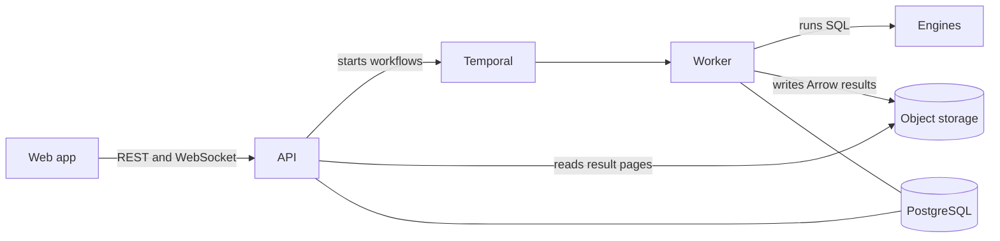

<h1 align="center">
  <br>
  Baleia
</h1>

<p align="center"><strong>A self-hosted SQL workspace for your data platform.</strong></p>

<p align="center">
  <a href="https://github.com/maltzsama/baleia/actions/workflows/ci.yml"></a>
  <a href="https://github.com/maltzsama/baleia/releases"></a>
  <a href="LICENSE"></a>
</p>

<p align="center">
  <a href="https://baleia.galileostd.io/"><b>Documentation</b></a> ·
  <a href="https://demo.baleia.galileostd.io/"><b>Live demo</b></a> ·
  <a href="docs/quick-start.md"><b>Quick start</b></a> ·
  <a href="https://github.com/maltzsama/baleia/releases"><b>Releases</b></a>
</p>

Baleia gives your team one place to write SQL against Trino and your databases, find and document the data, and share the queries, metrics and models built on it. It runs on your infrastructure, next to the engines you already have.

Baleia is a **control plane**, not another query engine. It manages connections, catalogs and engines, runs your SQL on those engines and keeps the results. Your BI tools and pipelines keep talking to the engines directly, and joins across sources stay the job of a federated engine such as Trino.

## Features

**Write and run SQL**
- An editor with tabs, autocomplete from your catalogs' metadata, join suggestions learned from your team's history, a function reference for each engine, formatting and `EXPLAIN`.
- Run a statement or a whole script; page through large results or export them as CSV, TSV, JSON Lines or Arrow.
- See where a run's time went: queue, planning, execution, and on Trino CPU, memory and the query profile.

**Find and understand your data**
- Browse every catalog in one tree, and search tables and columns with filters such as `tag:pii` or `certified:yes`.
- Document tables and columns next to the data: descriptions, tags, owners and certification.
- Follow lineage from a table to the saved queries, metrics and models that use it, and see what your workspace reads most.
- Open a table in Tableau or Power BI with one click.

**Share and reuse**
- Saved queries, metrics and semantic models live in team spaces, each with version history and a trash.
- Build questions in **Explore** by picking dimensions and metrics instead of writing SQL.
- Export a space to a bundle you can keep in Git and import into another instance.
- Materialize a query into an Iceberg table on a schedule with retrievers.

**Keep the engines healthy**
- Workload management queues runs per engine and class, so a heavy report cannot crowd out quick queries. Admin rules decide the class, and Trino's own resource groups can take over the queue.
- Watch the cluster, running queries and Iceberg table health, and maintain each Iceberg table with its own parameters.
- Prometheus metrics, alerts with runbooks, OpenTelemetry tracing and an audit trail of every security and data operation.

**Control access**
- Workspaces, teams and roles: a catalog granted to a workspace is reachable by its members only. Inside the catalog, the engine and the catalog manager decide what may be read or written: with per-user identity, Polaris, Unity or Lakekeeper authorize each user who signed in through an identity provider with their own token, while local and LDAP users act as the connection's account ([ADR 0015](docs/adr/0015-per-user-catalog-identity.md)).
- Sign in with OIDC or LDAP; personal API keys; credentials encrypted at rest.

**Bring in AI, if you want**
- An optional assistant that knows your catalogs, and an MCP server so your own agents can query within the limits you set.

The interface is available in English and Brazilian Portuguese.

## What it connects to

| | |
|---|---|
| **Federated engine** | Trino, with catalogs Baleia creates and keeps in sync |
| **Direct engines** | PostgreSQL, MySQL/MariaDB, SQL Server, Oracle, ClickHouse, Arrow Flight SQL, and SQLite files under `BALEIA_SQLITE_ROOT` |
| **Lakehouse catalogs** | Polaris, Nessie, Lakekeeper, Iceberg REST, Unity Catalog, AWS Glue, Hive Metastore |
| **Object storage** | Any S3-compatible store (AWS S3, RustFS, MinIO, Ceph, GCS, OCI) |

Register a lakehouse catalog once and Baleia sets up the matching Trino catalog for you. [Connections](docs/connections.md) has the details of each one.

## Get started

### Try it on your machine

You need Docker with Compose and `make`. This starts Baleia with Trino, Polaris, Temporal, PostgreSQL and S3-compatible storage:

```bash
git clone https://github.com/maltzsama/baleia.git
cd baleia
make up
```

Open http://localhost:8080. On the first visit, a setup wizard creates your admin account. The [quick start](docs/quick-start.md) walks you through your first query.

### Install on Kubernetes

Each release publishes multi-arch container images and a Helm chart:

```bash
helm install baleia oci://ghcr.io/maltzsama/charts/baleia --version 0.5.0 # x-release-please-version
```

[Install](docs/install.md) covers the chart's values, [configuration](docs/configuration.md) lists every setting, and [operations](docs/operations.md) covers upgrades, metrics, alerts and runbooks. Read the upgrade notes there before moving between minor versions.

## How it works



A Go API serves the web app (SvelteKit) and the REST API. Temporal workflows run everything long-running on a Go worker: executions, metadata syncs, catalog reconciliation and maintenance. Results are stored as Arrow files in object storage and read back page by page, so a large result never has to fit in the browser. [Architecture](docs/architecture.md) explains the parts and how a query runs, and the [decision records](docs/adr/README.md) explain why.

## Documentation

Everything is at **https://baleia.galileostd.io/**, built from [`docs/`](docs/):

| | |
|---|---|
| **Start** | [Quick start](docs/quick-start.md) · [Install](docs/install.md) · [Concepts](docs/concepts.md) |
| **Use** | [Workbench](docs/guides/workbench.md) · [Data explorer](docs/guides/data.md) · [Explore](docs/guides/explore.md) · [Content and retrievers](docs/guides/content.md) · [Monitoring](docs/guides/monitoring.md) · [Workload](docs/guides/workload.md) · [Administration](docs/guides/administration.md) |
| **Run** | [Configuration](docs/configuration.md) · [Operations](docs/operations.md) · [Connections](docs/connections.md) · [Secrets](docs/secrets.md) · [Observability](docs/observability.md) · [LDAP](docs/ldap.md) |
| **AI** | [Assistant](docs/assistant.md) · [MCP server](docs/mcp.md) |
| **Build** | [Architecture](docs/architecture.md) · [Development](docs/development.md) · [Releasing](docs/releasing.md) · [Decision records](docs/adr/README.md) |

## Status

Baleia is in beta and moving fast: expect changes between minor versions, and read the upgrade notes in [operations](docs/operations.md) before upgrading. Bugs and ideas are welcome in [issues](https://github.com/maltzsama/baleia/issues).

## Contributing

Help is welcome, especially on the web app (Svelte 5). Start with [development](docs/development.md) and [AGENTS.md](AGENTS.md), then open an issue or a pull request. Code, comments and docs are written in English.

## Credits

The Baleia icon is the ["pet" icon](https://www.flaticon.com/free-icon/pet_7688189)
by bsd from [Flaticon](https://www.flaticon.com)
([Tv show icons created by bsd - Flaticon](https://www.flaticon.com/free-icons/tv-show)),
used under its free license; the bundled fonts are under the SIL Open Font License.
See [CREDITS.md](CREDITS.md) for the attributions and license summaries.

## License

Apache 2.0. See [LICENSE](LICENSE).
