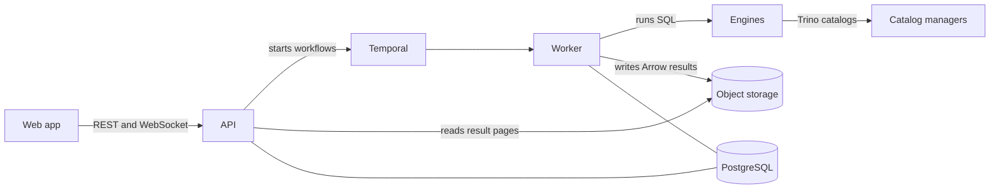

# Architecture

Baleia is a **control plane**: it manages connections, catalogs and engines, runs your SQL on those engines and shows the results. The engines are the data plane. Baleia is not a query proxy, a JDBC/ODBC/Flight SQL server or a federation layer: external clients talk to the engines directly, and joins across engines are the job of a federated engine such as Trino ([ADR 0001](adr/0001-control-plane-only.md)).

Architectural decisions are recorded in [`adr/`](adr/README.md). They are the current truth: where this page or the code disagrees with an ADR, the ADR's "Current compliance" section names the issue that closes the gap.

## Components

| Component | What it does |
|---|---|
| **Web app** (`web/`) | SvelteKit single-page app: workbench, data explorer, connections, content, monitoring, settings. |
| **API** (`cmd/api`) | Go HTTP server. The OpenAPI spec (`api/swagger.yaml`) is the contract. Serves the web app, the REST API, the execution WebSocket and `/mcp`. |
| **Worker** (`cmd/worker`) | Temporal worker: runs executions, metadata syncs, binding reconciliation, monitoring pollers and other recurring jobs. |
| **PostgreSQL** | Baleia's own metadata: users, workspaces, connections, catalogs, content, executions, audit. |
| **Object storage** | Any S3-compatible store (RustFS in the dev stacks) holding each statement's result as an Arrow file. |
| **Temporal** | Durable workflows for everything long-running. It carries ids and statuses, never result rows. |
| **Engines** | Where SQL runs: Trino (federated) and the direct engines PostgreSQL, MySQL/MariaDB, SQL Server, Oracle, SQLite, ClickHouse and Arrow Flight SQL ([ADR 0006](adr/0006-multi-engine-scope.md)). |
| **Catalog managers** | Polaris, Nessie, Lakekeeper, Iceberg REST, Unity, Glue and Hive Metastore, reached by Baleia for metadata and bound into Trino as catalogs ([connections.md](connections.md)). |

## How a query runs

1. You press Run (or ⌘/Ctrl+Enter). The web app sends the selection, or the statement at the cursor, with the target: engine, catalog binding and schema.
2. The API checks access, records the execution and starts a Temporal workflow.
3. The worker splits the script with the engine's dialect and runs the statements in order in one engine session (on Trino, as the signed-in user's Trino identity). It stops at the first error; the rest are marked skipped.
4. Each statement's rows are written to object storage as an Arrow file, capped by `BALEIA_RESULT_MAX_ROWS` and `BALEIA_RESULT_MAX_BYTES`.
5. The WebSocket sends status events only: a snapshot first, then statement and execution status. Rows never travel over it.
6. The web app reads the result in pages (`GET …/statements/{position}/results?offset=&limit=`). The API seeks the covering Arrow batches in the stored file, so neither side loads the whole result. Exports (CSV, TSV, JSON Lines, Arrow) stream from the same file.

## Trino security model

- **Three identities.** `BALEIA_TRINO_ADMIN_USER` (default `baleia_admin`) runs catalog DDL, reconciliation and Lens maintenance — it is **never** used to run user SQL. `BALEIA_TRINO_SERVICE_USER` (default `baleia`) is the worker's fallback identity. User queries run as the logged-in Baleia user's Trino identity (`BALEIA_TRINO_USER_IDENTITY`: `uuid` → `u_<uuid>`, or `email`) so `system.runtime.queries.user` reflects the real user.
- **The catalog guard is the control.** The `baleia-catalog-guard` access control (shipped by the catalog-store plugin) denies `CREATE/DROP CATALOG` and `SET SESSION AUTHORIZATION` to non-admin identities at the Trino level. The SQL editor's `IsForbiddenInEditor` gate (catalog DDL, `EXECUTE IMMEDIATE` smuggling catalog DDL, `SET SESSION AUTHORIZATION`) is UX and defense in depth, never the security boundary.
- **Trino is private.** The default compose stack does not publish Trino on the host; only the API/worker reach it via `expose`. Copy `docker-compose.override.yml.example` to publish it for local debugging.
- **Unauthenticated admin (network assumption).** Baleia's Trino has no authentication, so the admin identity reaches the guard without a verified principal. Compose and the minikube dev values set `baleia.allow-unauthenticated-admin=true`, which lets **any** client that can reach the coordinator connect as `BALEIA_TRINO_ADMIN_USER` and run `CREATE/DROP CATALOG`. That is safe only while Trino is reachable from the API and worker alone. The Helm chart defaults `trino.catalogGuard.allowUnauthenticatedAdmin` to `false`; with `false`, catalog management from Baleia is denied, so enable it only after restricting network access to the Trino service (e.g. a NetworkPolicy). Giving the API a real Trino credential, which removes the need for the flag, is planned.
- **Read-only mode.** A session opened with the read-only credential `baleia.mode=readonly` is denied every write/DDL check by the guard.

See [ADR 0005](adr/0005-trino-security-model.md) for the decision record.
