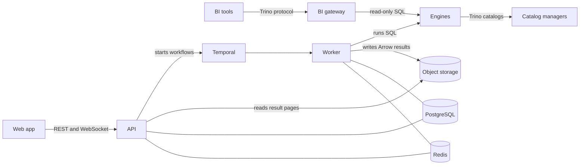

# Architecture

Baleia is a **control plane**: it manages connections, catalogs and engines, runs your SQL on those engines and shows the results. The engines are the data plane. Baleia is not a general-purpose query proxy, a federation layer or a JDBC/ODBC/Flight SQL server for arbitrary SQL: joins across engines stay the job of a federated engine such as Trino ([ADR 0001](adr/0001-control-plane-only.md)). External clients keep talking to the engines directly, with one exception: when the deployment keeps Trino private (the chart's NetworkPolicy; the default compose stack does not publish it), an external SQL client reaches Trino only through the **BI gateway** ([ADR 0017](adr/0017-bi-gateway.md)), read-only and scoped to a workspace, so Tableau and Power BI's queries land in history, audit and monitoring. Publishing Trino for local debugging, as the compose override does, opens a direct authenticated path.

Architectural decisions are recorded in [`adr/`](adr/README.md). They are the current truth: where this page or the code disagrees with an ADR, the ADR's "Current compliance" section names the issue that closes the gap.

## Components

| Component | What it does |
|---|---|
| **Web app** (`web/`) | SvelteKit single-page app: workbench, data explorer, connections, content, monitoring, settings. |
| **API** (`cmd/api`) | Go HTTP server. The OpenAPI spec (`api/swagger.yaml`) is the contract. Serves the web app, the REST API, the execution WebSocket, `/mcp` and the BI gateway listener. |
| **BI gateway** | A read-only listener (`internal/bigateway`, `BALEIA_BI_GATEWAY_ADDR`) that speaks the Trino HTTP client protocol, so Tableau and Power BI query the Trino engines through Baleia, scoped to a workspace ([ADR 0017](adr/0017-bi-gateway.md)). Only Trino engines are served. |
| **Worker** (`cmd/worker`) | Temporal worker: runs executions, metadata syncs, binding reconciliation, monitoring pollers and other recurring jobs. |
| **PostgreSQL** | Baleia's own metadata: users, workspaces, connections, catalogs, content, executions, audit. PostgreSQL is the default; the GORM store ([ADR 0020](adr/0020-gorm-store.md)) also runs on MySQL/MariaDB. |
| **Redis** | The shared real-time, cache and rate-limit backbone ([ADR 0022](adr/0022-shared-realtime-backbone.md)): it relays execution status to the WebSocket across replicas, backs the shared cache and the distributed rate limiter, and carries monitoring and assistant events. |
| **Object storage** | Any S3-compatible store (RustFS in the dev stacks) holding each statement's result as an Arrow file, and the cold copies of the audit trail and query history, offloaded one UTC day at a time as gzip NDJSON objects and a manifest per day to a configured S3-compatible bucket ([ADR 0024](adr/0024-cold-storage-and-retention.md), [ADR 0026](adr/0026-daily-partitions-and-retention-cadence.md)). |
| **Temporal** | Durable workflows for everything long-running. It carries ids and statuses, never result rows. |
| **Engines** | Where SQL runs: Trino (federated) and the direct engines PostgreSQL, MySQL/MariaDB, SQL Server, Oracle, SQLite, ClickHouse and Arrow Flight SQL ([ADR 0006](adr/0006-multi-engine-scope.md)). |
| **Catalog managers** | Polaris, Nessie, Lakekeeper, Iceberg REST, Unity, Glue and Hive Metastore, reached by Baleia for metadata and bound into Trino as catalogs ([connections.md](connections.md)). |

## How a query runs

1. You press Run (or ⌘/Ctrl+Enter). The web app sends the selection, or the statement at the cursor, with the target: engine, catalog binding and schema.
2. The API checks access, decides the run's workload class, records the execution and starts a Temporal workflow. With [workload management](guides/workload.md) on, the workflow first asks the engine's admission workflow for a slot in that class, and the execution is `queued` until it gets one.
3. The worker splits the script with the engine's dialect and runs the statements in order in one engine session (on Trino, as the signed-in user's Trino identity). It stops at the first error; the rest are marked skipped.
4. Each statement's rows are written to object storage as an Arrow file, capped by `BALEIA_RESULT_MAX_ROWS` and `BALEIA_RESULT_MAX_BYTES`.
5. The web app follows the run on the execution WebSocket. With Redis on, a status change commits with a row in the transactional outbox, a relay publishes a wake-up on the bus, and the WebSocket handler on every replica re-reads the execution and its statements (the database is the source of truth) and sends the diff. Without Redis, the API does not start the relay and each connection polls the database instead. It sends a snapshot first — execution and statement SQL included — then status changes, queue position, admission events and statement progress; it never sends result rows.
6. The web app reads the result in pages (`GET …/statements/{position}/results?offset=&limit=`). The API seeks the covering Arrow batches in the stored file, so neither side loads the whole result. Exports (CSV, TSV, JSON Lines, Arrow) stream from the same file.

## Trino security model

- **Three identities.** `BALEIA_TRINO_ADMIN_USER` (default `baleia_admin`) runs catalog DDL, reconciliation and Lens maintenance — it is **never** used to run user SQL. `BALEIA_TRINO_SERVICE_USER` (default `baleia`) is the worker's fallback identity. User queries run as the logged-in Baleia user's Trino identity (`BALEIA_TRINO_USER_IDENTITY`: `uuid` → `u_<uuid>`, or `email`) so `system.runtime.queries.user` reflects the real user.
- **The catalog guard is the control.** The `baleia-catalog-guard` access control (shipped by the catalog-store plugin) denies `CREATE/DROP CATALOG` and `SET SESSION AUTHORIZATION` to non-admin identities at the Trino level. The SQL editor's `IsForbiddenInEditor` gate (catalog DDL, `EXECUTE IMMEDIATE` smuggling catalog DDL, `SET SESSION AUTHORIZATION`) is UX and defense in depth, never the security boundary.
- **Trino is private.** The default compose stack does not publish Trino on the host; only the API/worker reach it via `expose`. Copy `docker-compose.override.yml.example` to publish it for local debugging. The chart ships a NetworkPolicy that admits only the API and worker pods (`trino.networkPolicy`, on by default), which takes effect when the cluster's CNI enforces NetworkPolicy.
- **The bundled Trino requires authentication (#647).** Compose and the Helm chart run it with HTTPS and password authentication; plain HTTP refuses clients. Baleia logs in as `BALEIA_TRINO_ADMIN_USER` with `BALEIA_TRINO_PASSWORD` (#646) and trusts the coordinator's CA (`BALEIA_TRINO_CA_FILE`). The base access control is file-based: only that login may impersonate other identities, so no other client can claim a Baleia user, and catalogs stay open (`owner`). The catalog guard is stacked after it with `baleia.allow-unauthenticated-admin=false`, so catalog management needs the authenticated admin. A client without the password gets `401`; another login cannot impersonate, claim the admin or manage catalogs.
- **The catalog manager authorizes each user (#648, [ADR 0015](adr/0015-per-user-catalog-identity.md)).** Catalogs bound from a connection set to per-user identity use `iceberg.rest-catalog.session=USER`. Every query session carries a bearer token as the extra credential `token`, filled by the worker or API when the session opens (`queryengine.CatalogCredentials`, never in workflow input): the user's identity-provider access token, kept sealed in `user_idp_tokens` and refreshed before it expires; or, for users without one and background work, the token of the connection behind the session's catalog. A user whose identity-provider session ended carries none and is refused. Glue, Hive Metastore and Nessie act as the connection's account for every user.
- **Read-only mode.** A session opened with the read-only credential `baleia.mode=readonly` is denied every write/DDL check by the guard. Baleia uses it for MCP agents whose owner is a viewer of the workspace (#653), the built-in assistant, semantic custom SQL and its own probes; a workspace grant never opens a read-only session (#651).

See [ADR 0005](adr/0005-trino-security-model.md) for the decision record.
